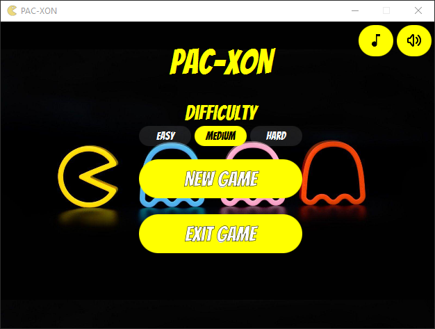
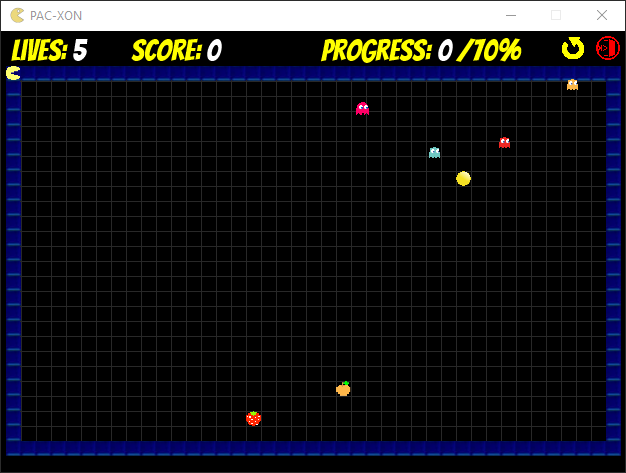
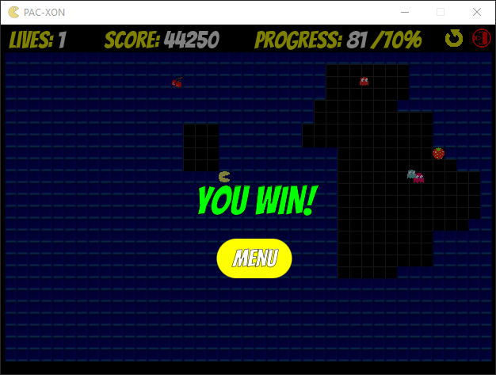
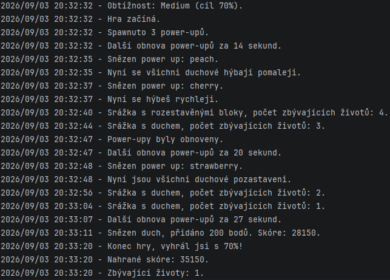

# PAC-XON

![Java](https://img.shields.io/badge/Java-0074BD?logo=)
![JavaFX](https://img.shields.io/badge/JavaFX-597993?logo=)
![Scene Builder](https://img.shields.io/badge/Scene%20Builder-F68A1F?logo=)


Classic PAC-XON game implemented in JavaFX.

## Overview

PAC-XON is a reimplementation of the classic arcade game where you control Pacman, draw paths and claim territory while avoiding ghosts. The game combines maze navigation with territory control mechanics.

## Tech stack

- **Language:** Java
- **Framework:** JavaFX
- **GUI:** Scene Builder
- **Build:** Maven

## Features

- Classic PAC-XON gameplay
- Multiple difficulty levels (Easy, Medium, Hard)
- Power-ups: Peach, Strawberry, Cherry, Ball
- Four distinct ghosts with unique movement
- Keyboard controls (Arrow keys + WASD)
- In-game restart and menu buttons
- Background music and sound effects
- Progress tracking and score system

## Screenshots






## Installation

### Prerequisites

- Java 21 or higher

### Option 1: Download pre-built JAR

1. Download the latest `.jar` from [Releases](https://github.com/mk-forge/pac-xon/releases).
2. Double-click the JAR file or run:
```bash
java -jar pac-xon-1.0.0.jar
```

### Option 2: Build from source

Clone the repository and build with Maven:

```bash
git clone https://github.com/mk-forge/pac-xon.git
cd pac-xon
mvn clean package
java -jar target/pac-xon-1.0.0.jar
```

Or run directly from your IDE by executing the `App` class.

## Difficulty

| Difficulty | Territory to win |
|------------|------------------|
| Easy       | 50%              |
| Medium     | 70%              |
| Hard       | 90%              |

## Power-ups

| Power-up   | Effect                                      |
|------------|---------------------------------------------|
| Peach      | Slows down all ghosts for 5 seconds         |
| Strawberry | Stops all ghosts for 5 seconds              |
| Cherry     | Speeds up Pacman for 5 seconds              |
| Ball       | Makes ghosts eatable for 5 seconds          |

## Known issue

### Orange ghost respawn

In the original PAC-XON game, the orange ghost respawns after being eaten. In this implementation, the orange ghost does not respawn. This is a deliberate design decision due to a technical limitation where the orange ghost would sometimes respawn in a position where it couldn't move properly.

If you want to restore the original behavior, modify `applyBallEffect()` in `Map.java` by removing the condition `if (i != 0)` that skips the orange ghost during respawn.

## Credits

- Music and sound effects from Pixabay (Pixabay Content License).
- Font Bangers from Google Fonts (OFL License).

## License

[MIT](LICENSE)